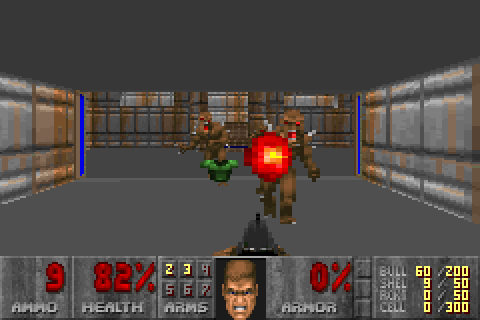
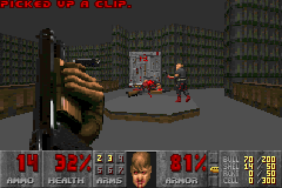

# femto-doom

Doom was released by id Software in 1993 for DOS PCs with 4 MB of RAM. Its source code was
published in 1997 and put under the GPL in 1999. Since then Doom has been ported to almost
anything with a screen, but nearly always with megabytes of RAM, the game data loaded into it and
a frame buffer.

femto-doom is based on [Doom64KB](https://github.com/FrenkelS/Doom64KB) by Frenkel Smeijers, which
runs Doom in 64 KB of RAM with the game data in ROM. femto-doom goes further: E1M1 runs in about
16 KB of RAM, with all game data read in place from read-only memory.

femto-doom is only the engine, a C library behind a single header. The platform provides game
data, time and input, and draws the engine's output.

<p>


</p>

## Features

- Shareware episode: all nine maps, all monsters
- A few KB of RAM: packed map data, sleeping monsters take no memory, decorations little, no recursion
- Game data read in place, never loaded
- WAD reads optionally through the platform, e.g. from external flash
- No frame buffer: columns, rows and pictures go straight to the platform
- Any screen size
- 3D view up to 320 pixels wide
- Detail traded for memory at build time: wall and sprite resolution, table sizes, partial status bar refresh
- Rotating automap over the 3D view
- Untextured floors and ceilings
- No light diminishing
- Sound effects as events, samples from the platform
- No music, no saving, no multiplayer

## Getting started

femto-doom ships no game data. `tools/femtowad` builds its two WADs from Doom's shareware IWAD,
`doom1.wad`:

```bash
uv run --project tools/femtowad femtowad wads doom1.wad out/
```

Then compile `src/` together with your platform layer. `examples/host` is one without a screen; it
prints frame hashes and saves screenshots:

```bash
make -C examples/host
examples/host/host out/GRAPHICS.WAD out/MAPS.WAD -shot 500 shot.ppm
make -C examples/host check WADS=$PWD/out
```

Documentation:

- [docs/platform.md](docs/platform.md): building the engine, platform interface
- [docs/build.md](docs/build.md): build options
- [docs/wad-format.md](docs/wad-format.md): the WADs and the tool that builds them

## Licence

GPL-2.0, see [LICENSE](LICENSE).
